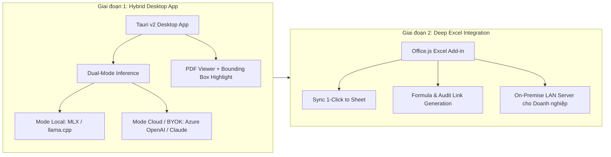
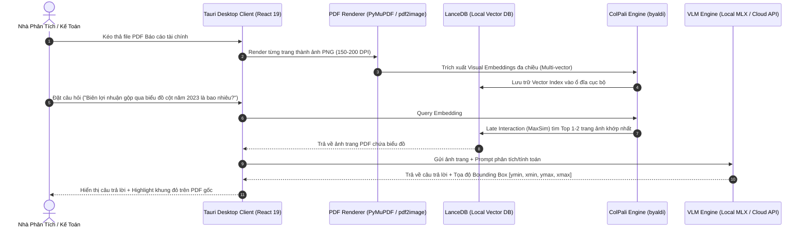

# [PRD & Tech Spec] FinSight — Nền tảng Trợ Lý Phân Tích Báo Cáo Tài Chính bằng Visual RAG (Hybrid Desktop & Excel Add-in)

> **Ngày khởi tạo:** 16/11/2026 | **Tác giả:** 529 Studio Architecture Team  
> **Trạng thái:** Approved / In Progress  
> **Tham chiếu Outline:** `https://docs.529studio.site/doc/prd-arch-ke-hoach-dac-ta-ky-thuat-du-an-finsight-visual-financial-rag-hybrid-app-FEFdOfdITh`

---

## 1. Tên Gọi Sản Phẩm (Naming Proposals)

Để sản phẩm ngắn gọn, dễ nhớ, mang phong thái tin cậy cho giới tài chính và gợi mở ngay tính năng "thị giác":

- [x] **FinSight** *(Lựa chọn chính thức)*:
  * Ghép giữa **Financial** và **Sight / Insight**.
  * Ý nghĩa: Vừa mang lại thông tin phân tích sâu sắc (Insight), vừa nhấn mạnh khả năng "nhìn thấu" (Sight) các biểu đồ, hình ảnh mà AI truyền thống bị mù.
- [ ] **FinLens**:
  * Chiếc "thấu kính" soi chiếu mọi ngóc ngách của báo cáo tài chính, chú thích chân trang và biểu đồ phức tạp.
- [ ] **Ledgex**:
  * Ghép giữa **Ledger** (Sổ cái kế toán) và hậu tố **X** (Next-gen / Vision). Nghe rất hiện đại, công nghệ cao.
- [ ] **SheetEye**:
  * Trực diện, gợi nhớ ngay đến "mắt thần cho bảng tính Excel", cực kỳ thân thuộc với dân kế toán / phân tích.

*(Codename chính thức của dự án: **FinSight**).*

---

## 2. Bối Cảnh & Tầm Nhìn Sản Phẩm (Vision & Problem Statement)

### 2.1. "Tử huyệt" của RAG truyền thống trong Báo cáo tài chính (BCTC)

RAG dạng văn bản truyền thống (Text-based chunking + text embedding như OpenAI text-embedding-3 hay BGE) thất bại thảm hại khi ứng dụng vào phân tích BCTC doanh nghiệp bởi 3 "tử huyệt" chí mạng:

1. **Mù biểu đồ (Charts & Graphs Blindness):**
   * BCTC hiện đại, báo cáo thường niên (Annual Report), bản cáo bạch chứa đầy biểu đồ trực quan: cơ cấu doanh thu theo mảng, tăng trưởng YoY, biên lợi nhuận gộp/ròng qua các quý, biểu đồ dòng tiền dạng thác nước (waterfall chart).
   * OCR và text parser truyền thống hoàn toàn bất lực trước biểu đồ: hoặc bỏ qua 100% hình ảnh, hoặc bóc ra các chuỗi ký tự rác rời rạc không có trục tọa độ (X/Y axes) và chú giải màu sắc (legends). Kết quả: RAG trả lời "không tìm thấy dữ liệu".

2. **Vỡ cấu trúc bảng (Complex Tables Fragmentation):**
   * Bảng Cân đối kế toán (Balance Sheet) và Báo cáo Lưu chuyển tiền tệ (Cash Flow Statement) có hàng chục cột số liệu (Quý này, Quý trước, Lũy kế đầu năm, Cùng kỳ năm trước) cùng hệ thống phân cấp nhiều tầng (Tài sản ngắn hạn -> Tiền -> Các khoản tương đương tiền).
   * Khi thuật toán chunking dựa trên số ký tự hoặc dấu phân đoạn cắt đôi bảng biểu, ngữ cảnh giao điểm dòng-cột bị phá hủy hoàn toàn. AI không thể biết con số 125 tỷ nằm ở quý nào hay thuộc mã tài khoản nào.

3. **Mất liên kết chú thích chân trang (Footnotes Severance):**
   * Trong giới kiểm toán và tài chính chuyên nghiệp, "sự thật luôn nằm ở chân trang". Những thông tin cốt tử (rủi ro nợ xấu tiềm tàng, tranh chấp pháp lý, phương pháp trích lập dự phòng, thay đổi thời gian khấu hao) thường nằm ở phần ghi chú chân trang (footnotes) hoặc thuyết minh BCTC.
   * Chunking truyền thống cắt rời các chú thích này khỏi bảng biểu chính, khiến LLM đưa ra phân tích ngây thơ và nguy hiểm.

### 2.2. Giải pháp: Visual RAG (V-RAG)

FinSight giải quyết triệt để 3 tử huyệt trên bằng kiến trúc **Visual RAG** thế hệ mới:

- **Nguyên lý cốt lõi:** Coi mỗi trang tài liệu là một **bức ảnh độ phân giải cao** nguyên bản (150–200 DPI PNG). Giữ nguyên vẹn 100% layout không gian, font chữ, màu sắc, vị trí tương đối giữa bảng số liệu và biểu đồ minh họa.
- **Tìm kiếm thị giác (Visual Retrieval with ColPali):**
  * Ứng dụng mô hình **ColPali** (dựa trên ColBERT + VLM patch embeddings).
  * ColPali chia bức ảnh thành các visual patches và sinh multi-vector embedding. Khi người dùng đặt câu hỏi, cơ chế **Late Interaction (MaxSim)** so khớp trực tiếp giữa token câu hỏi và các patch ảnh, định vị chính xác trang có biểu đồ/bảng liên quan mà hoàn toàn không cần bước trung gian OCR text.
- **Suy luận thị giác (VLM Visual Reasoning):**
  * Đưa trực tiếp ảnh trang gốc vào Vision-Language Model (`Qwen2.5-VL` hoặc `Claude 3.5 Sonnet` / `GPT-4o`).
  * VLM có khả năng "nhìn" trục tọa độ biểu đồ, so sánh cột màu, đọc chính xác chú thích chân trang và tính toán số liệu tài chính.
- **Bằng chứng thị giác (Visual Grounding & Audit Trail):**
  * VLM không chỉ trả về câu trả lời bằng văn bản mà còn trả về tọa độ hộp giới hạn: `[ymin, xmin, ymax, xmax]` (chuẩn hóa tỷ lệ 0-1000).
  * Ứng dụng vẽ khung viền đỏ (Bounding Box highlight) ngay trên trang PDF gốc. Khi người dùng nhấp vào số liệu, ứng dụng tự động nhảy đến đúng trang và chớp sáng vùng biểu đồ làm bằng chứng kiểm toán (Audit Trail).

---

## 3. Lộ Trình Phát Triển 2 Giai Đoạn (2-Phase Product Strategy)

### Giai đoạn 1: Hybrid Desktop App (Windows & macOS)

- **Hình thức:** Ứng dụng Desktop độc lập xây dựng trên **Tauri v2 (Rust + React 19 + TypeScript + Tailwind CSS)**.
- **Lý do chọn Hybrid:**
  * Giới tài chính dùng Windows chiếm >85%, nhưng laptop văn phòng mỏng nhẹ thường không có GPU mạnh.
  * Hỗ trợ **Dual-Engine** linh hoạt:
    * **Local Engine:** Tự động kích hoạt khi chạy trên macOS Apple Silicon (thông qua engine `mlx-vlm`) hoặc PC có card NVIDIA RTX (thông qua `llama.cpp` CUDA). Bảo mật 100%, dữ liệu không rời khỏi máy, chi phí API = 0.
    * **Cloud / BYOK (Bring Your Own Key):** Dành cho máy tính văn phòng cấu hình tiêu chuẩn. Cho phép người dùng nhập API Key của Anthropic (Claude 3.5 Sonnet), OpenAI hoặc endpoint **Azure OpenAI** bảo mật của doanh nghiệp.

### Giai đoạn 2: Deep Excel Integration & B2B Expansion

- **Hình thức:** Microsoft Office Web Add-in (`Office.js`) nhúng trực tiếp trong Microsoft Excel (chạy mượt trên Windows Excel, Mac Excel và Excel Web).
- **Tính năng chủ lực:**
  * Kéo thả PDF vào thanh bên (Sidebar) của Excel.
  * Lệnh trích xuất: AI tự động đọc các bảng/biểu đồ trong PDF và **điền thẳng số liệu vào các cell trong Sheet**, tự sinh công thức tính toán tài chính (`SUM`, `CAGR`, `GROWTH`).
  * Mỗi ô số liệu đều ghim một "Audit Trail Link": click vào ô tính là sidebar mở ngay ảnh chụp gốc chứng minh số liệu đó được lấy từ đâu trong PDF.
- **Phiên bản Enterprise ("Team Box"):** Đóng gói backend thành một container server đặt tại mạng LAN của doanh nghiệp (On-Premise), giải quyết triệt để yêu cầu bảo mật ngân hàng/kiểm toán.

---

## 4. Kiến Trúc Kỹ Thuật Chi Tiết (Technical Specifications)

### 4.1. Sơ đồ luồng dữ liệu (Data Pipeline)

### 4.2. Tech Stack Chi Tiết

| Thành phần | Công nghệ lựa chọn | Lý do & Vai trò |
|:-----------|:-------------------|:----------------|
| **Desktop Shell** | **Tauri v2** (Rust + React 19 + TypeScript + Tailwind) | Bộ cài siêu nhẹ (<20MB), tốn ít RAM hơn Electron 10 lần, bảo mật cao, hỗ trợ cả Windows (.msi/.exe) và macOS (.dmg). |
| **PDF Rendering** | `PyMuPDF` (`fitz`) / `pdf2image` | Render nhanh, chính xác từng trang PDF thành định dạng ảnh PNG chuẩn 150–200 DPI. |
| **Visual Retrieval Engine** | **ColPali** (Dựa trên kiến trúc ColBERT + VLM / `byaldi`) | Định vị chính xác biểu đồ/bảng biểu dựa trên visual patches mà không cần OCR. |
| **Local Vector Database** | **LanceDB** | Serverless, nhúng trực tiếp dạng file cục bộ, hỗ trợ cực tốt đa vector (multi-vector) của ColPali, tốc độ truy vấn mili-giây. |
| **Local VLM (macOS)** | `mlx-vlm` chạy `Qwen2.5-VL-7B-Instruct` (Quant 4-bit) | Tối ưu hóa tối đa trên chip Apple Silicon M-series, đọc tiếng Việt và biểu đồ tài chính xuất sắc. |
| **Local VLM (Windows)** | `llama.cpp` (với Vulkan / CUDA backend) | Chạy mô hình Qwen2.5-VL trên máy tính có GPU NVIDIA. |
| **Cloud VLM Router** | `LiteLLM` adapter (Claude 3.5 Sonnet / Azure OpenAI GPT-4o) | Định tuyến linh hoạt sang các model đám mây mạnh nhất khi người dùng bật chế độ Cloud BYOK. |
| **Office Integration (P2)** | `Office.js` (React / Fluent UI) | Chuẩn add-in hiện đại của Microsoft, chạy đồng nhất trên Windows Excel, Mac Excel và Web. |

---

## 5. Ma Trận Tương Thích Phần Cứng (Compatibility Matrix)

| Nền tảng | Cấu hình máy | Chế độ khuyến nghị | Trải nghiệm thực tế |
|:---------|:-------------|:-------------------|:--------------------|
| **macOS** | Apple Silicon M-series (16GB – 36GB+ RAM) | **Full Local (MLX Engine)** | Tốc độ trích xuất và trả lời biểu đồ tức thì (vài giây), bảo mật 100% offline. |
| **macOS** | Mac Intel cũ hoặc 8GB RAM | **Cloud API / BYOK** | Máy đóng vai trò client giao diện, việc xử lý VLM đẩy lên Azure/Claude. |
| **Windows** | PC / Workstation có NVIDIA RTX (>= 8GB VRAM) | **Local (CUDA)** | Chạy offline qua backend llama.cpp. |
| **Windows** | Laptop văn phòng (Intel Iris Xe, Core Ultra mỏng nhẹ) | **Cloud API / BYOK** | Nhẹ nhàng, không tốn pin, không nóng máy, độ chính xác tối đa qua API. |

---

## 6. Kế Hoạch Triển Khai Chi Tiết (Execution Milestones)

### Sprint 1: Nghiên Cứu Lõi & Thử Nghiệm Visual RAG (PoC)
- [ ] Thu thập bộ dữ liệu kiểm thử (10 BCTC kiểm toán thực tế của Vinamilk, Hòa Phát, Vietcombank, Apple 10-K có biểu đồ phức tạp).
- [ ] Viết script benchmark ColPali (`byaldi`) trên tập dữ liệu này: Đo tỷ lệ tìm đúng trang chứa biểu đồ cụ thể (Top-1 Recall).
- [ ] Đánh giá khả năng đọc biểu đồ của `Qwen2.5-VL` qua `mlx-vlm` so với Claude 3.5 Sonnet (đo độ sai lệch số liệu trích xuất).

### Sprint 2: Phát Triển Giao Diện Desktop (Tauri v2 MVP)
- [ ] Dựng khung ứng dụng Tauri v2 với layout Split-View (Màn hình chia đôi):
  * **Cột trái:** Trình xem PDF (PDF.js) với khả năng vẽ lớp phủ Bounding Box toạ độ.
  * **Cột phải:** Khung chat hỏi đáp tài chính.
- [ ] Xây dựng tính năng "Click-to-Source": Nhấp vào câu trả lời, PDF tự cuộn đến đúng trang và chớp sáng vùng biểu đồ liên quan.

### Sprint 3: Hoàn Thiện Dual-Engine & Đóng Gói
- [ ] Cấu hình Backend Core: Cho phép chuyển đổi linh hoạt giữa Engine Local (`mlx-vlm`) và Cloud API (`Azure OpenAI / Claude`).
- [ ] Thiết lập bảng quản lý cấu hình (API Keys, chỉnh DPI render, chọn model).
- [ ] Đóng gói bộ cài đặt: Tạo GitHub Actions workflow build ra file `.dmg` (macOS Universal) và `.msi/.exe` (Windows).

### Sprint 4: Khởi Động Module Excel Add-in & Báo Cáo Doanh Nghiệp
- [ ] Tạo dự án Office.js Add-in kết nối với backend FinSight qua REST/WebSocket cục bộ.
- [ ] Xây dựng tính năng thử nghiệm: "1-Click Export to Table" (Bóc tách dữ liệu biểu đồ/bảng từ PDF đẩy thẳng vào Sheet tính).
- [ ] Đóng gói tài liệu triển khai On-Premise cho khách hàng doanh nghiệp.

---

## 7. Quy Chuẩn Đánh Giá (DoD) & Bằng Chứng Xác Thực
Mọi sprint và tính năng của FinSight đều phải tuân thủ nghiêm ngặt **529 Studio Engineering Standards**:
1. Không đưa ra khẳng định suông — bắt buộc cung cấp bằng chứng chạy thực tế (cURL / log trace / UI rendering).
2. Dữ liệu tài chính không được phép bịa đặt số liệu (Zero Hallucination Tolerance). Mọi số liệu đưa ra phải đi kèm tọa độ Bounding Box để người dùng kiểm chứng.
3. Ký ức kiến trúc và bài học kinh nghiệm phải được ghi chép vào Lore và `docs/lesson_learn.md`.
