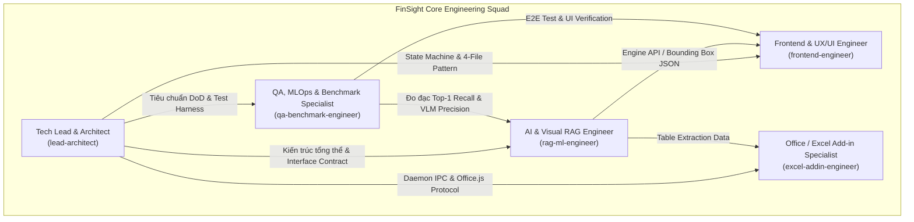
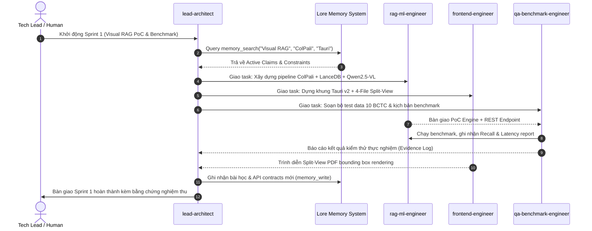

# FinSight — Cơ Cấu Đội Ngũ Subagents & Quy Chế Teamwork Phần Mềm

> **Mô hình tổ chức:** Autonomous Software Engineering Pod (Squad)  
> **Quy chuẩn vận hành:** 529 Studio Engineering Standards & Lore Persistent Memory Protocol  
> **Áp dụng cho:** Đội ngũ AI Coding Agents (Antigravity CLI Subagents, Claude Code, Cursor)

---

## 1. Triết Lý Vận Hành Đội Ngũ (Squad Operating Principles)

Để phát triển một sản phẩm công nghệ cao kết hợp giữa **Thị giác máy tính (Visual AI)**, **Hệ thống Desktop hiệu năng cao (Tauri v2 + Rust)** và **Tích hợp sâu B2B (Microsoft Office.js)**, đội ngũ subagents được tổ chức như một Software Engineering Squad hoàn chỉnh, tuân thủ 4 nguyên tắc sắt:

1. **Chuyên môn hóa theo Vai trò (Separation of Concerns):** Mỗi subagent đảm nhiệm một vai trò duy nhất, có ranh giới module rõ ràng, sở hữu một thư mục riêng trong codebase và chịu trách nhiệm về chất lượng module đó.
2. **Ký ức dùng chung qua Lore (Single Source of Verifiable Truth):** Mọi agent trước khi code đều phải tra cứu Lore (`memory_search` / `lore search`) để không lặp lại sai lầm trong quá khứ hoặc phá vỡ các quyết định kiến trúc đã thống nhất. Mọi quyết định/API mới đều phải ghi nhận vào Lore (`memory_write`).
3. **Bằng chứng trước Khẳng định (Evidence Before Assertions):** Theo chuẩn `evidence-based-dod-and-llm-guardrails` của 529 Studio, không agent nào được tuyên bố "đã xong" (Done) nếu không có bằng chứng chạy thực tế (terminal execution log, cURL test, JSON output, hoặc visual snapshot).
4. **Hợp đồng giao tiếp bất biến (Contract-First IPC):** Giao tiếp giữa Frontend (Tauri React) và Core AI Engine (Python Daemon) hoặc Excel Add-in phải thông qua OpenAPI Schema / Type-safe DTO đã được duyệt trong `docs/adr/`.

---

## 2. Roster Phân Vai Đội Ngũ Subagents (Agent Roles & Ownership)

---

### Vai trò 1: Tech Lead & System Architect (`lead-architect`)
- **Mã định danh:** `lead-architect`
- **Thư mục làm chủ:** `apps/desktop/src-tauri/`, `docs/adr/`, `AGENTS.md`, `lore.ontology.yml`
- **Trách nhiệm chính:**
  1. Bảo vệ ranh giới kiến trúc Clean Architecture, ngăn ngừa code coupling.
  2. Thiết kế hệ thống IPC giữa Tauri v2 (Rust) và Python AI Engine (Sidecar hoặc Local HTTP Daemon).
  3. Quản trị Lore memory: kiểm soát xung đột (conflicts), chạy `lore verify`, `lore gc`, và duyệt các ADRs.
  4. Giám sát tuân thủ 6 kỹ năng tiêu chuẩn của 529 Studio: `module-boundary-and-concurrency`, `env-and-auth-ops-debugging`, `resilient-networking-and-waf`.

---

### Vai trò 2: AI / ML & Visual RAG Engineer (`rag-ml-engineer`)
- **Mã định danh:** `rag-ml-engineer`
- **Thư mục làm chủ:** `packages/core-engine/`
- **Trách nhiệm chính:**
  1. Xây dựng pipeline xử lý tài liệu PDF: PyMuPDF render trang sang PNG 150-200 DPI.
  2. Tích hợp mô hình tìm kiếm thị giác **ColPali** (`byaldi`) và vector store nhúng **LanceDB** (hỗ trợ multi-vector indexing & MaxSim late interaction).
  3. Xây dựng bộ điều phối **Dual-Engine VLM Router**:
     * Local Mode: `mlx-vlm` chạy `Qwen2.5-VL-7B-Instruct` 4-bit (macOS Apple Silicon) hoặc `llama.cpp` (Windows CUDA).
     * Cloud Mode: `LiteLLM` adapter kết nối Claude 3.5 Sonnet / Azure OpenAI.
  4. Thiết kế System Prompt chuẩn mực cho VLM để trả về cấu trúc JSON nghiêm ngặt chứa:
     * `answer`: Lời giải thích, phân tích và trích xuất số liệu.
     * `bounding_boxes`: Danh sách tọa độ `[ymin, xmin, ymax, xmax]` theo tỷ lệ chuẩn `[0, 1000]`.
     * `confidence_score`: Độ tin cậy trích xuất.
  5. Đóng gói engine thành HTTP / WebSocket Daemon nhẹ nhàng chạy trên `127.0.0.1:8765`.

---

### Vai trò 3: Frontend & UX/UI Engineer (`frontend-engineer`)
- **Mã định danh:** `frontend-engineer`
- **Thư mục làm chủ:** `apps/desktop/src/`
- **Trách nhiệm chính:**
  1. Xây dựng giao diện ứng dụng Desktop trên React 19 + TypeScript + Tailwind CSS.
  2. Nghiêm túc thực thi chuẩn **Frontend 4-File Architecture** của 529 Studio:
     * `*.types.ts`: DTOs và Interfaces.
     * `*.fetch.ts`: Data Fetching chống WAF và timeout.
     * `*.hook.ts`: State management & business logic hook.
     * `*.component.tsx`: Presentational component với **3 UI States bắt buộc**: Skeleton Loading, Error State with Retry, Empty State with Action.
  3. Triển khai bố cục **Split-View**:
     * **Panel Trái:** PDF Viewer (dựa trên PDF.js) với lớp Canvas/SVG Overlay vẽ bounding boxes màu đỏ sắc nét.
     * **Panel Phải:** Khung Chat hỏi đáp tài chính, hỗ trợ render Markdown, bảng biểu tài chính đẹp mắt.
  4. Tính năng "Click-to-Source": Khi người dùng bấm vào số liệu hoặc nút nguồn ở khung chat, PDF Viewer tự động chuyển trang mượt mà (smooth scroll) và nhấp nháy (flash pulse animation) vùng biểu đồ bằng chứng.
  5. Đảm bảo Kiosk Ergonomics: Mọi nút bấm, icon thao tác tối thiểu 48px, tương thích cảm ứng và thao tác chuột nhanh.

---

### Vai trò 4: Office / Excel Integration Specialist (`excel-addin-engineer`)
- **Mã định danh:** `excel-addin-engineer`
- **Thư mục làm chủ:** `packages/office-addin/`
- **Trách nhiệm chính:**
  1. Phát triển Microsoft Office Web Add-in (`Office.js`) chuẩn hóa cho Excel Desktop (Windows/Mac) và Excel Web.
  2. Thiết kế Manifest XML và giao diện Sidebar Fluent UI / React.
  3. Kết nối với FinSight Core Daemon (`127.0.0.1:8765`) để đồng bộ dữ liệu theo thời gian thực.
  4. Tính năng "1-Click Export to Sheet": Nhận JSON trích xuất bảng biểu từ AI Engine và ghi thẳng dữ liệu vào các ô Excel (`context.workbook.worksheets.getActiveWorksheet().getRange()`), tự động thiết lập định dạng số tiền tệ và sinh công thức tính tổng (`=SUM(...)`).
  5. Thiết lập "Audit Trail Link": Gắn hyperlink hoặc comment vào ô Excel trích xuất, khi người dùng bấm vào sẽ kích hoạt xem ảnh nguồn PDF gốc.

---

### Vai trò 5: QA, Benchmarking & MLOps Specialist (`qa-benchmark-engineer`)
- **Mã định danh:** `qa-benchmark-engineer`
- **Thư mục làm chủ:** `benchmarks/`, `tests/`
- **Trách nhiệm chính:**
  1. Xây dựng bộ dữ liệu benchmark thực chiến gồm 10 Báo cáo tài chính kiểm toán có biểu đồ và bảng phức tạp (Vinamilk, Hòa Phát, Vietcombank, Apple 10-K).
  2. Viết harness tự động đo lường:
     * **Top-1 / Top-3 Retrieval Recall** của ColPali so với Text-RAG truyền thống trên các câu hỏi biểu đồ.
     * **Extraction Accuracy**: Tỷ lệ trích xuất đúng số liệu giữa Qwen2.5-VL và Claude 3.5 Sonnet.
     * **Latency & Memory Footprint**: Thời gian phản hồi và mức chiếm dụng RAM/VRAM trên macOS (MLX) và Windows (CPU/CUDA).
  3. Thi hành cổng kiểm duyệt **Definition of Done (DoD)**: Xác nhận bằng chứng chạy thực nghiệm trước khi merge code của bất kỳ subagent nào.

---

## 3. Quy Trình Phối Hợp & Giao Nhận (Subagent Workflow Protocol)

---

## 4. Bảng Tra Cứu Subagent Tooling & Commands

| Tên Subagent | Lệnh Khởi Tạo Khuyến Nghị | Công Cụ Thiết Yếu |
|:-------------|:--------------------------|:------------------|
| `lead-architect` | `invoke_subagent(TypeName: "self", Role: "Tech Lead & System Architect")` | `read_file`, `write_file`, `edit_file`, `run_command`, `lore` |
| `rag-ml-engineer` | `invoke_subagent(TypeName: "self", Role: "Visual RAG & AI Engineer")` | `read_file`, `write_file`, `run_command` (python, mlx, lancedb) |
| `frontend-engineer` | `invoke_subagent(TypeName: "self", Role: "Frontend Desktop Engineer")` | `read_file`, `write_file`, `run_command` (pnpm, tauri, vite) |
| `excel-addin-engineer` | `invoke_subagent(TypeName: "self", Role: "Office Excel Specialist")` | `read_file`, `write_file`, `run_command` (office-addin-debugging) |
| `qa-benchmark-engineer` | `invoke_subagent(TypeName: "self", Role: "QA & Benchmark Specialist")` | `read_file`, `write_file`, `run_command` (pytest, benchmark) |
