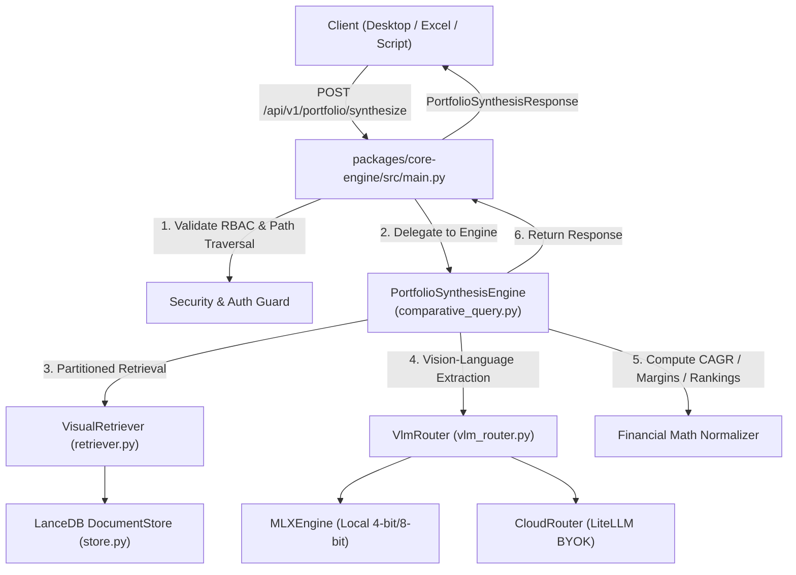

# [Tech Spec] S11-01: Multi-Document Portfolio Synthesis & Cross-Filing Comparative Analytics

**Document**: `docs/superpowers/specs/2026-11-23-s11-01-portfolio-comparative-analytics-design.md`  
**Date**: 2026-11-23  
**Status**: DRAFT - PENDING APPROVAL  
**Author**: rag-ml-engineer & lead-architect  
**Issue Reference**: #86 (`[rag-ml] S11-01: Multi-Document Portfolio Synthesis & Cross-Filing Comparative Analytics`)  
**Applicable Rules**: AGENTS.md Rules 1, 2, 3, 11, 12, 13, 14, 15  

---

## 1. Executive Summary & Problem Context

Financial analysts reviewing corporate filings frequently need to evaluate cross-filing performance:
1. **Multi-Year Trend Analysis (Single Enterprise)**: Analyzing 3–5 consecutive years of BCTC to calculate Compound Annual Growth Rate (CAGR), YoY margin trajectory (Gross Margin, Net Margin), and structural shifts in capital allocation.
2. **Peer Group Benchmarking (Cross-Enterprise)**: Comparing multiple competitors within an industry (e.g. Vinamilk `VNM` vs. Đường Quảng Ngãi `QNS` vs. Mộc Châu `MCM`) for the same fiscal period to establish relative valuations, margin efficiency, and peer rankings.

Existing capabilities in FinSight provided a baseline comparative query (`POST /api/v1/query/comparative`) for simple cross-document text queries. However, it lacks:
- Deterministic multi-period financial mathematics (CAGR, margin trends, variance analysis).
- Portfolio-level aggregations (total portfolio revenue, weighted margins, peer ranking).
- A clean, extensible domain engine decoupled from `main.py` routing logic.

**Task S11-01** delivers `PortfolioSynthesisEngine` in `packages/core-engine/src/comparative_query.py` and a dedicated endpoint `POST /api/v1/portfolio/synthesize`.

---

## 2. Architecture & Module Boundaries (Rule 1 & `module-boundary-and-concurrency`)

### 2.1 Monorepo Module Decoupling

Following the black-box module boundary standard:
- **`packages/core-engine/src/contracts.py`**: Declares all request/response DTOs, data structures, and Pydantic validation models.
- **`packages/core-engine/src/comparative_query.py`**: Pure domain service (`PortfolioSynthesisEngine`) implementing financial math, metadata fallback resolution, cross-document metric alignment, and peer ranking. It accepts store/retriever and router dependencies via dependency injection (`deps`).
- **`packages/core-engine/src/main.py`**: Thin HTTP controller mounting `POST /api/v1/portfolio/synthesize`, enforcing RBAC permissions (`Permission.DOC_READ`), rate limits, and path traversal validation.



---

## 3. Data Contracts (`contracts.py`)

### 3.1 Input Models

```python
from enum import Enum
from typing import List, Optional, Dict, Any
from pydantic import BaseModel, Field, field_validator

class BenchmarkRole(str, Enum):
    TARGET = "target"
    PEER = "peer"
    BENCHMARK = "benchmark"

class PortfolioDocumentTarget(BaseModel):
    document_id: str = Field(..., description="Unique document ID in LanceDB store")
    entity: Optional[str] = Field(None, description="Enterprise ticker or name (e.g. VNM, HPG)")
    period: Optional[str] = Field(None, description="Fiscal period (e.g. 2021, 2022, 2023, 2023-Q4)")
    role: BenchmarkRole = Field(BenchmarkRole.PEER, description="Role in portfolio analysis")

    @field_validator("document_id")
    @classmethod
    def validate_document_id(cls, v: str) -> str:
        if not re.match(r"^[a-zA-Z0-9_\-]+$", v):
            raise ValueError(f"Invalid document_id '{v}': must be alphanumeric with dashes/underscores.")
        return v

class PortfolioSynthesisRequest(BaseModel):
    documents: List[PortfolioDocumentTarget] = Field(..., min_length=2, max_length=10)
    query_text: Optional[str] = Field(
        "Tổng hợp hiệu quả kinh doanh, tốc độ tăng trưởng doanh thu và biên lợi nhuận giữa các kỳ báo cáo.",
        description="Specific analytical focus query"
    )
    metrics_requested: List[str] = Field(
        default_factory=lambda: [
            "revenue", "gross_profit", "net_profit", "gross_margin", "net_margin", "cagr_revenue"
        ],
        description="Target financial metrics to calculate and cross-reference"
    )
    inference_mode: str = Field("auto", description="'local', 'cloud', or 'auto'")
```

### 3.2 Output Models

```python
class TimeSeriesDataPoint(BaseModel):
    period: str
    value: Optional[float]
    unit: str = "VND"
    yoy_growth: Optional[float] = None # Percentage YoY delta e.g. +12.5%
    evidence: Optional[GroundedEvidence] = None

class EntityMetricSeries(BaseModel):
    entity: str
    metric: str
    series: List[TimeSeriesDataPoint]
    cagr: Optional[float] = None # Compound Annual Growth Rate (e.g. 0.084 for 8.4%)

class PeerRankingItem(BaseModel):
    rank: int
    entity: str
    period: str
    metric_value: float
    metric_name: str
    growth_rate: Optional[float] = None
    evidence: Optional[GroundedEvidence] = None

class PortfolioSummary(BaseModel):
    total_entities: int
    total_periods: int
    portfolio_revenue_aggregate: Optional[float] = None
    weighted_net_margin: Optional[float] = None
    fastest_growing_entity: Optional[str] = None
    highest_margin_entity: Optional[str] = None

class PortfolioSynthesisResponse(BaseModel):
    portfolio_summary: PortfolioSummary
    time_series_metrics: List[EntityMetricSeries]
    peer_rankings: List[PeerRankingItem]
    synthesis_narrative: str
    evidences: List[GroundedEvidence]
    retrieved_pages: Dict[str, List[int]]
    latency_ms: float
    engine_used: str
```

---

## 4. Algorithmic Specifications & Financial Mathematics

### 4.1 Hybrid Metadata Fallback Resolution Chain

When `entity` or `period` are `None`:
1. **Regex Pattern Matching on `document_id`**:
   - Expression: `^(?P<entity>[a-zA-Z0-9]+)[_\-](?P<period>\d{4}(?:[_\-]Q[1-4])?|[a-zA-Z0-9]+)`
   - Examples:
     * `VNM_2023_AUDITED` $\to$ entity: `VNM`, period: `2023`
     * `HPG-2022-ANNUAL` $\to$ entity: `HPG`, period: `2022`
2. **LanceDB Stored Metadata Fallback**:
   - Inspect stored document metadata if available.
3. **VLM Title Page Inspection**:
   - If regex cannot extract a valid 4-digit year, inspect candidate title page for `BÁO CÁO TÀI CHÍNH NĂM [YYYY]`.

### 4.2 Deterministic Financial Calculations

1. **YoY Growth ($\Delta\%$):**
   $$\Delta\% = \frac{V_t - V_{t-1}}{|V_{t-1}|} \times 100\%$$
   - Edge case: $V_{t-1} = 0 \implies \text{None}$.
   - IEEE-754 precision normalization: `round(val, 4)`.

2. **Compound Annual Growth Rate (CAGR):**
   $$CAGR = \left(\frac{V_n}{V_0}\right)^{\frac{1}{n}} - 1$$
   - Where $n$ is the number of years spanned ($T_n - T_0$).
   - Pre-condition: $V_0 > 0$ and $V_n > 0$. If either $\le 0$, CAGR is mathematically undefined ($\text{None}$).

3. **Margin Trajectories:**
   $$\text{Gross Margin} = \frac{\text{Gross Profit}}{\text{Revenue}} \times 100\%$$
   $$\text{Net Margin} = \frac{\text{Net Profit}}{\text{Revenue}} \times 100\%$$

4. **Peer Group Rankings:**
   - Entities sorted in descending order by the evaluated metric (e.g. Net Margin or Revenue).
   - Rank assigned $1, 2, \dots, K$.

---

## 5. Security, Zero-Leak & Guardrails (Rules 2, 13B, 15)

1. **Path Traversal Defense**:
   - All `document_id` fields strictly validated against `^[a-zA-Z0-9_\-]+$`.
   - Maximum 10 documents per synthesis request to prevent DoS.
2. **Zero-Leak Policy**:
   - Sensitive credentials, API keys, or JWT tokens scrubbed from logs.
3. **Memory Ceiling (< 6GB Metal Unified Memory)**:
   - Partitioned retrieval executes sequentially across documents; document image buffers freed immediately after visual grounding extraction.
4. **Zero-Emoji Policy (Rule 15)**:
   - 0 raw emojis in narrative summaries, responses, or UI. Clean text status and badges only.

---

## 6. Verification & Test Plan

1. **Unit Tests (`packages/core-engine/tests/test_portfolio_synthesis.py`)**:
   - `test_metadata_resolution_hybrid`: Verify regex fallback and explicit metadata precedence.
   - `test_cagr_calculation_accuracy`: Verify multi-year CAGR with exact decimal checks and boundary conditions ($V_0 \le 0$).
   - `test_margin_trajectory_and_yoy`: Verify gross and net margin deltas.
   - `test_peer_ranking_ordering`: Verify correct descending sorting.
   - `test_path_traversal_rejection`: Reject malicious `document_id` patterns (`../../etc/passwd`).
2. **Integration Test (FastAPI TestClient)**:
   - `test_portfolio_synthesize_endpoint_e2e`: Post request with 2-3 documents, verify response payload structure, latency, and visual grounding coordinates $[0, 1000]$.
3. **DoD Compliance**:
   - 100% pass rate in pytest suite.
   - Subagent audit sign-off before merge into `dev`.
