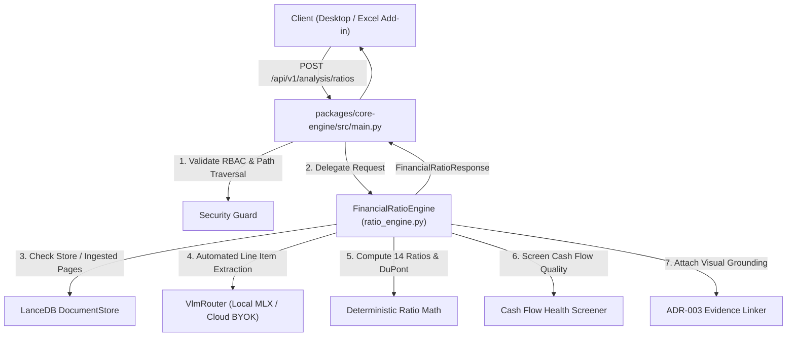

# [Tech Spec] S11-02: Automated Financial Ratio Calculation Engine & Cash Flow Health Screener

**Document**: `docs/superpowers/specs/2026-11-24-s11-02-financial-ratio-cash-flow-engine-design.md`  
**Date**: 2026-11-24  
**Status**: DRAFT - PENDING APPROVAL  
**Author**: rag-ml-engineer & lead-architect  
**Issue Reference**: #88 (`[rag-ml] S11-02: Automated Financial Ratio Calculation Engine & Cash Flow Health Screener`)  
**Applicable Rules**: AGENTS.md Rules 1, 2, 3, 11, 12, 13B, 14, 15  

---

## 1. Executive Summary & Problem Context

Financial statement auditing and credit appraisal require systematic evaluation of an enterprise's financial soundness across four fundamental pillars:
1. **Liquidity (Thanh khoản)**: Ability to satisfy short-term obligations as they mature without distress.
2. **Solvency & Capital Structure (Đòn bẩy & Cơ cấu vốn)**: Long-term financial stability, leverage, and debt-servicing capacity.
3. **Profitability & Operational Efficiency (Sinh lời & Hiệu quả vận hành)**: Return on investment and multi-factor DuPont decomposition.
4. **Cash Flow Quality & Health (Chất lượng dòng tiền)**: Detecting earnings manipulation or "paper profit" where net income is high but operating cash flow is persistently negative.

In prior sprints, FinSight focused on individual table extraction and multi-document comparative synthesis. **Task S11-02** introduces `FinancialRatioEngine` in `packages/core-engine/src/ratio_engine.py` and endpoint `POST /api/v1/analysis/ratios` to deliver:
- Automated extraction and calculation of 14 standard financial ratios.
- DuPont 3-stage decomposition ($\text{ROE} = \text{Net Margin} \times \text{Asset Turnover} \times \text{Financial Leverage}$).
- Automated Cash Flow Health Screener classifying earnings quality into grades (`STRONG`, `MODERATE`, `CAUTION`, `DISTRESS`).
- 100% visual grounding linking each input metric back to its exact bounding box on the source PDF.

---

## 2. Architecture & Module Boundaries (Rule 1 & `module-boundary-and-concurrency`)

Following strict black-box module boundary architecture:
- **`packages/core-engine/src/contracts.py`**: Declares Pydantic request/response models (`FinancialRatioRequest`, `FinancialRatioResponse`, `FinancialStatementInputs`, `RatioItem`, `RatioCategoryGroup`, `DuPontAnalysis`, `CashFlowHealthScore`).
- **`packages/core-engine/src/ratio_engine.py`**: Pure domain service (`FinancialRatioEngine`) implementing ratio mathematics, DuPont decomposition, cash flow health grading, and visual extraction coordination. Injected with `store`, `retriever`, and `router`.
- **`packages/core-engine/src/main.py`**: Thin controller exposing `POST /api/v1/analysis/ratios`, guarded by `require_permission(Permission.DOC_READ)` and strict path traversal validation.



---

## 3. Data Contracts (`contracts.py`)

### 3.1 Input Models

```python
from enum import Enum
from typing import List, Optional, Dict, Any
from pydantic import BaseModel, Field, field_validator
import re

class FinancialStatementInputs(BaseModel):
    """Raw financial statement line items (in VND or reporting currency)."""
    # Income Statement
    revenue: Optional[float] = Field(None, description="Doanh thu thuần")
    gross_profit: Optional[float] = Field(None, description="Lợi nhuận gộp")
    operating_profit: Optional[float] = Field(None, description="Lợi nhuận từ HĐKD (EBIT)")
    net_income: Optional[float] = Field(None, description="Lợi nhuận sau thuế (LNST)")
    interest_expense: Optional[float] = Field(None, description="Chi phí lãi vay")
    
    # Balance Sheet
    current_assets: Optional[float] = Field(None, description="Tài sản ngắn hạn")
    cash_and_equivalents: Optional[float] = Field(None, description="Tiền và tương đương tiền")
    inventories: Optional[float] = Field(None, description="Hàng tồn kho")
    total_assets: Optional[float] = Field(None, description="Tổng tài sản")
    current_liabilities: Optional[float] = Field(None, description="Nợ ngắn hạn")
    total_liabilities: Optional[float] = Field(None, description="Tổng nợ phải trả")
    equity: Optional[float] = Field(None, description="Vốn chủ sở hữu")
    
    # Cash Flow Statement
    operating_cash_flow: Optional[float] = Field(None, description="Lưu chuyển tiền thuần từ HĐKD (OCF)")
    capex: Optional[float] = Field(None, description="Tiền chi mua sắm TSCĐ (Capital Expenditures)")


class FinancialRatioRequest(BaseModel):
    document_id: str = Field(..., description="Unique document ID in LanceDB store")
    raw_inputs_override: Optional[FinancialStatementInputs] = Field(
        None, description="Optional manual overrides for financial line items"
    )
    include_dupont: bool = Field(True, description="Compute 3-stage DuPont decomposition")
    include_cash_flow_screening: bool = Field(True, description="Execute cash flow health screener")
    inference_mode: str = Field("auto", description="'local', 'cloud', or 'auto'")

    @field_validator("document_id")
    @classmethod
    def validate_document_id(cls, v: str) -> str:
        if not v or not re.match(r"^[a-zA-Z0-9_\-]+$", v):
            raise ValueError(f"document_id '{v}' must be strictly alphanumeric with dashes or underscores")
        if len(v) > 64:
            raise ValueError(f"document_id '{v}' must not exceed 64 characters")
        return v
```

### 3.2 Output Models

```python
class RatioCategory(str, Enum):
    LIQUIDITY = "liquidity"
    SOLVENCY = "solvency"
    PROFITABILITY = "profitability"
    EFFICIENCY = "efficiency"


class BenchmarkStatus(str, Enum):
    OPTIMAL = "optimal"
    ADEQUATE = "adequate"
    WARNING = "warning"
    CRITICAL = "critical"
    NOT_APPLICABLE = "not_applicable"


class RatioItem(BaseModel):
    code: str = Field(..., description="Machine-readable ratio code e.g. current_ratio")
    name: str = Field(..., description="Human-readable name in Vietnamese / English")
    category: RatioCategory
    value: Optional[float] = None
    unit: str = "x" # "x", "%", "days"
    benchmark_status: BenchmarkStatus = BenchmarkStatus.NOT_APPLICABLE
    formula_description: str
    evidences: List[GroundedEvidence] = Field(default_factory=list)


class RatioCategoryGroup(BaseModel):
    category: RatioCategory
    ratios: List[RatioItem]


class DuPontAnalysis(BaseModel):
    net_profit_margin: Optional[float] = Field(None, description="Net Income / Revenue (%)")
    asset_turnover: Optional[float] = Field(None, description="Revenue / Total Assets (x)")
    equity_multiplier: Optional[float] = Field(None, description="Total Assets / Equity (x)")
    roe: Optional[float] = Field(None, description="Return on Equity (%)")
    formula_narrative: str
    evidences: List[GroundedEvidence] = Field(default_factory=list)


class CashFlowHealthGrade(str, Enum):
    STRONG = "STRONG"         # OCF > 0, FCF > 0, OCF/NetIncome >= 1.0
    MODERATE = "MODERATE"     # OCF > 0, OCF/NetIncome >= 0.8
    CAUTION = "CAUTION"       # OCF > 0 but OCF/NetIncome < 0.5 or FCF < 0
    DISTRESS = "DISTRESS"     # OCF < 0 (Negative operating cash flow)


class CashFlowHealthScore(BaseModel):
    grade: CashFlowHealthGrade
    earnings_quality_ratio: Optional[float] = Field(None, description="OCF / Net Income")
    free_cash_flow: Optional[float] = Field(None, description="OCF - Capex (VND)")
    ocf_to_current_debt: Optional[float] = Field(None, description="OCF / Current Liabilities")
    health_summary: str
    warning_signals: List[str] = Field(default_factory=list)
    evidences: List[GroundedEvidence] = Field(default_factory=list)


class FinancialRatioResponse(BaseModel):
    document_id: str
    ratio_groups: List[RatioCategoryGroup]
    dupont_analysis: Optional[DuPontAnalysis] = None
    cash_flow_health: Optional[CashFlowHealthScore] = None
    raw_inputs_used: FinancialStatementInputs
    evidences: List[GroundedEvidence]
    latency_ms: float
    engine_used: str
```

---

## 4. Mathematical Specifications & Cash Flow Screener Logic

### 4.1 Ratios Formula Matrix & Benchmarks

1. **Liquidity:**
   - **Current Ratio**: $\frac{\text{Current Assets}}{\text{Current Liabilities}}$  
     * Benchmark: $\ge 2.0 \implies \text{OPTIMAL}$, $1.2 \le x < 2.0 \implies \text{ADEQUATE}$, $1.0 \le x < 1.2 \implies \text{WARNING}$, $< 1.0 \implies \text{CRITICAL}$.
   - **Quick Ratio**: $\frac{\text{Current Assets} - \text{Inventories}}{\text{Current Liabilities}}$  
     * Benchmark: $\ge 1.0 \implies \text{OPTIMAL}$, $0.8 \le x < 1.0 \implies \text{ADEQUATE}$, $< 0.8 \implies \text{WARNING}$.
   - **Cash Ratio**: $\frac{\text{Cash \& Equivalents}}{\text{Current Liabilities}}$  
     * Benchmark: $\ge 0.5 \implies \text{OPTIMAL}$, $0.2 \le x < 0.5 \implies \text{ADEQUATE}$, $< 0.2 \implies \text{WARNING}$.

2. **Solvency & Leverage:**
   - **Debt-to-Equity (D/E)**: $\frac{\text{Total Liabilities}}{\text{Equity}}$  
     * Benchmark: $\le 1.0 \implies \text{OPTIMAL}$, $1.0 < x \le 2.0 \implies \text{ADEQUATE}$, $2.0 < x \le 3.0 \implies \text{WARNING}$, $> 3.0 \implies \text{CRITICAL}$.
   - **Debt-to-Assets**: $\frac{\text{Total Liabilities}}{\text{Total Assets}}$  
     * Benchmark: $\le 0.5 \implies \text{OPTIMAL}$, $0.5 < x \le 0.7 \implies \text{ADEQUATE}$, $> 0.7 \implies \text{WARNING}$.
   - **Financial Leverage (Equity Multiplier)**: $\frac{\text{Total Assets}}{\text{Equity}}$
   - **Interest Coverage**: $\frac{\text{Operating Profit (EBIT)}}{\text{Interest Expense}}$  
     * Benchmark: $\ge 3.0 \implies \text{OPTIMAL}$, $1.5 \le x < 3.0 \implies \text{ADEQUATE}$, $< 1.5 \implies \text{CRITICAL}$.

3. **Profitability:**
   - **Gross Margin**: $\frac{\text{Gross Profit}}{\text{Revenue}} \times 100\%$
   - **Operating Margin**: $\frac{\text{Operating Profit}}{\text{Revenue}} \times 100\%$
   - **Net Margin**: $\frac{\text{Net Income}}{\text{Revenue}} \times 100\%$
   - **ROA**: $\frac{\text{Net Income}}{\text{Total Assets}} \times 100\%$
   - **ROE**: $\frac{\text{Net Income}}{\text{Equity}} \times 100\%$

4. **DuPont 3-Stage Decomposition:**
   $$\text{ROE} = \left(\frac{\text{Net Income}}{\text{Revenue}} \times 100\%\right) \times \left(\frac{\text{Revenue}}{\text{Total Assets}}\right) \times \left(\frac{\text{Total Assets}}{\text{Equity}}\right)$$

### 4.2 Cash Flow Health Screening Logic

- **Earnings Quality Ratio ($EQ = \frac{OCF}{Net Income}$)**:
  - If $Net Income > 0$ and $OCF \ge Net Income$: Earnings backed by real cash flows.
  - If $Net Income > 0$ and $OCF < 0.5 \times Net Income$: Warning signal — high accruals / uncollected receivables.
- **Free Cash Flow ($FCF = OCF - Capex$)**:
  - $FCF > 0$: Company generates surplus cash after capital expenditures.
  - $FCF < 0$: Organic cash insufficient to cover reinvestment.
- **Grading Matrix:**
  - `STRONG`: $OCF > 0$, $FCF > 0$, and $EQ \ge 1.0$.
  - `MODERATE`: $OCF > 0$, $EQ \ge 0.8$.
  - `CAUTION`: $OCF > 0$, but ($EQ < 0.5$ or $FCF < 0$).
  - `DISTRESS`: $OCF < 0$ (operating activity burns cash).

---

## 5. Security, Zero-Leak & Guardrails (Rules 2, 13B, 15)

1. **Path Traversal Defense**:
   - `document_id` strictly checked against regex `^[a-zA-Z0-9_\-]+$`.
2. **Division-by-Zero & Negative Denominator Safety**:
   - Every denominator strictly checked against $0.0$. Returns `None` gracefully instead of raising runtime exceptions.
   - Negative equity ($Equity \le 0$) flags `CRITICAL` insolvency without arithmetic overflow.
3. **IEEE-754 Precision**:
   - All ratio calculations normalized with `round((val + 1e-9), 4)`.
4. **Zero-Emoji Policy (Rule 15)**:
   - 0 raw Unicode emojis in narrative summaries or benchmark status codes. Clean text formatting exclusively.

---

## 6. Verification & Test Plan

1. **Unit Tests (`packages/core-engine/tests/test_ratio_engine.py`)**:
   - `test_liquidity_ratios_calculation_and_benchmarks`
   - `test_solvency_and_leverage_ratios_edge_cases`
   - `test_profitability_and_dupont_decomposition`
   - `test_cash_flow_health_screener_grades`
   - `test_zero_division_and_negative_equity_safety`
   - `test_financial_ratio_contracts_validation`
2. **Integration Tests (FastAPI TestClient)**:
   - `test_api_ratios_endpoint_with_override_inputs`
   - `test_api_ratios_endpoint_automated_extraction`
   - `test_api_ratios_endpoint_path_traversal_rejection`
   - `test_api_ratios_endpoint_unauthorized_token`
   - `test_api_ratios_endpoint_missing_document`
3. **DoD Compliance**:
   - 100% test pass rate across core engine test suite.
   - Independent subagent audit sign-off before merge into `dev`.
