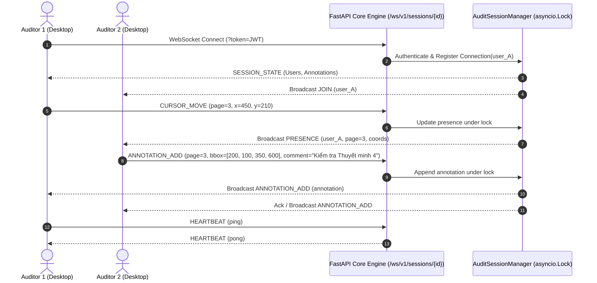

# S11-03: Real-Time Collaborative Audit Session Sync via Secure WebSockets — Design Specification

## Overview
During corporate audit workflows (such as analyzing Vietnamese audited financial reports / BCTC), multiple analysts and senior auditors must concurrently review documents, highlight disclosures, inspect multi-page notes, and record audit annotations without overwriting each other's work or losing spatial context.

Task **S11-03** introduces a real-time, low-latency collaborative synchronization architecture using secure WebSockets with JWT authorization, spatial visual coordinate anchoring ([0, 1000] BoundingBox coordinates), peer presence tracking, and resilient connection management.

---

## Architectural Principles & Standards Compliance
1. **Module Boundary & Concurrency (`module-boundary-and-concurrency`)**:
   - `packages/core-engine/src/session_sync.py` is an isolated domain module.
   - All state mutations are protected by `asyncio.Lock` to eliminate race conditions between concurrent WebSocket frames.
2. **Resilient Networking (`resilient-networking-and-waf`)**:
   - Heartbeat frames (every 15s) prevent idle TCP socket teardown and silent proxy drops.
   - Exponential backoff reconnection in the client hook (`useSessionSync`).
3. **Frontend 4-File Pattern & Ergonomics (`frontend-4file-and-resilient-ui`)**:
   - DTO Types: `apps/desktop/src/types/session_sync.types.ts`
   - Custom Hook: `apps/desktop/src/hooks/useSessionSync.ts`
   - UI Component: `apps/desktop/src/components/pdf/CollaborativeSessionBar.tsx`
   - 3 UI States: Connecting (Skeleton), Error with Retry, Empty (No peers online).
   - Kiosk ergonomics: Minimum `48px` clickable touch targets on interactive controls.
4. **Zero-Emoji Policy (AGENTS.md Rule 15)**:
   - 0 raw Unicode emojis. Strictly Lucide React SVG iconography (`Users`, `Wifi`, `WifiOff`, `MessageSquare`, `CheckCircle2`, `AlertCircle`, `RefreshCw`).
5. **Zero-Leak & Injection Defense (AGENTS.md Rule 2 & Rule 13B)**:
   - `session_id` strictly validated against `^[a-zA-Z0-9_-]{3,64}$`.
   - JWT tokens validated via HMAC-SHA256 (`decode_access_token`) before establishing session membership.
   - Document ID traversal defended.

---

## Component Architecture



---

## Data Contracts (`packages/core-engine/src/contracts.py`)

```python
class SessionEventType(str, Enum):
    JOIN = "join"
    LEAVE = "leave"
    PRESENCE = "presence"
    ANNOTATION_ADD = "annotation_add"
    ANNOTATION_RESOLVE = "annotation_resolve"
    ANNOTATION_DELETE = "annotation_delete"
    HEARTBEAT = "heartbeat"
    SESSION_STATE = "session_state"
    ERROR = "error"

class UserPresence(BaseModel):
    user_id: str
    name: str
    role: str
    color: str
    active_page: int = 1
    cursor_x: Optional[float] = None
    cursor_y: Optional[float] = None
    last_seen: float = Field(default_factory=time.time)

class AuditAnnotation(BaseModel):
    annotation_id: str
    document_id: str
    page_number: int
    bounding_box: List[float] = Field(..., min_length=4, max_length=4)
    comment: str
    author_id: str
    author_name: str
    created_at: float = Field(default_factory=time.time)
    resolved: bool = False
    resolved_by: Optional[str] = None

class SessionState(BaseModel):
    session_id: str
    document_id: str
    created_at: float
    active_users: Dict[str, UserPresence] = Field(default_factory=dict)
    annotations: List[AuditAnnotation] = Field(default_factory=list)
```

---

## Verification & Testing Plan
- **Backend Tests (`packages/core-engine/tests/test_session_sync.py`)**:
  - Connect multiple clients to session via TestClient WebSocket.
  - Verify `SESSION_STATE` received on join.
  - Verify `PRESENCE` broadcasts to peer clients.
  - Verify `ANNOTATION_ADD` and `ANNOTATION_RESOLVE` state persistence.
  - Verify input sanitization (reject invalid `session_id` traversal e.g. `../../bad`).
  - Verify heartbeat & prune stale users.
- **Frontend Tests (`apps/desktop/src/components/pdf/__tests__/CollaborativeSessionBar.test.tsx`)**:
  - Verify 3 UI states: Connecting (Skeleton), Error with Retry button, Empty (Waiting for peers).
  - Verify touch target ergonomics (`min-h-[48px]`).
  - Verify 0 raw Unicode emojis.
- **E2E Live Verification**:
  - Run daemon on port 8765, connect 2 independent WebSocket clients, exchange annotations and presence.
