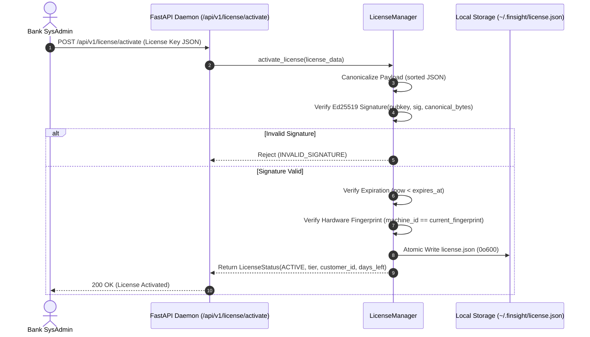

# S11-04: Offline Air-Gapped License Key Cryptographic Activation & Hardware Fingerprinting — Design Specification

## Overview
Enterprise banking institutions and government regulatory bodies operate inside air-gapped intranet environments where servers have no outbound access to the public internet. Consequently, conventional phone-home license verification servers (SaaS licensing APIs) fail completely.

Task **S11-04** introduces an offline, tamper-evident cryptographic license activation engine for FinTrace using:
1. **One-Way Hardware Fingerprinting**: SHA-256 machine identity bound to hardware primitives without leaking raw MAC addresses or serial numbers (AGENTS.md Rule 2 Zero-Leak).
2. **Ed25519 Asymmetric Digital Signatures**: High-speed, high-assurance digital signature verification with embedded vendor public keys.
3. **Graceful Multi-Tier Fallback**: Transparent operational modes (`COMMUNITY_EVALUATION`, `PROFESSIONAL`, `ENTERPRISE`, `EXPIRED`, `INVALID_SIGNATURE`).
4. **Tamper-Evident Storage**: Atomic file writing to `~/.finsight/license.json` with restricted Unix file permissions (`0o600`).

---

## Architectural Principles & Standards Compliance
1. **Zero-Leak Security (AGENTS.md Rule 2)**:
   - Hardware serials and raw MAC addresses are hashed with an internal salt before storage or inspection.
   - Private signing keys are NEVER bundled into daemon binaries or runtime code; only the vendor Ed25519 verification public key is embedded.
2. **Module Boundary & Concurrency (`module-boundary-and-concurrency`)**:
   - `packages/core-engine/src/licensing.py` is self-contained with no external cloud dependencies.
   - In-memory license cache is protected against concurrent read-modify-write via Python `threading.Lock`.
3. **Evidence-Based DoD (`evidence-based-dod-and-llm-guardrails`)**:
   - Verification covers positive signature matches, negative tampering tampering, expired tokens, machine mismatch, and zero-leak payload checks.
4. **Zero-Emoji Policy (AGENTS.md Rule 15)**:
   - 0 raw Unicode emojis in code, logs, and API payloads.

---

## License Key Architecture



---

## Data Contracts (`packages/core-engine/src/contracts.py`)

```python
class LicenseTier(str, Enum):
    COMMUNITY = "community"
    PROFESSIONAL = "professional"
    ENTERPRISE = "enterprise"

class LicenseState(str, Enum):
    ACTIVE = "active"
    EXPIRED = "expired"
    INVALID_SIGNATURE = "invalid_signature"
    FINGERPRINT_MISMATCH = "fingerprint_mismatch"
    COMMUNITY_EVALUATION = "community_evaluation"

class LicensePayload(BaseModel):
    customer_id: str
    customer_name: str
    tier: LicenseTier
    issued_at: float
    expires_at: float
    max_users: int = 10
    features: List[str]
    machine_fingerprint: str  # Hex string or "*" for floating

class LicenseFileDTO(BaseModel):
    payload: LicensePayload
    signature: str  # Base64url encoded Ed25519 signature

class LicenseStatusResponse(BaseModel):
    state: LicenseState
    is_valid: bool
    tier: LicenseTier
    customer_id: Optional[str]
    customer_name: Optional[str]
    machine_fingerprint: str
    days_remaining: Optional[int]
    max_users: int
    features: List[str]
    expires_at: Optional[float]
```
