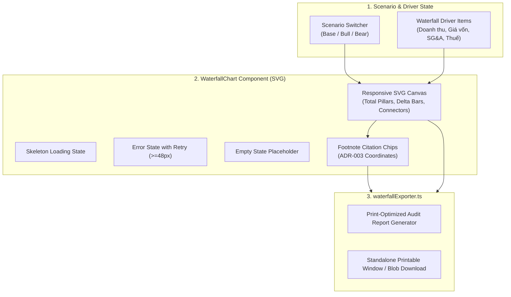

# S11-05: Excel Add-in Scenario Comparison Waterfall Chart & PDF Grounding Export — Design Specification

## Overview
During corporate valuation, credit risk assessment, and financial audits, analysts evaluate how different operating assumptions (Base, Bull, Bear scenarios) affect bottom-line profitability (Net Income / LNST). A **Waterfall Chart** provides the clearest visual variance decomposition from Revenue to Operating Profit to Net Income, highlighting how discrete cost and margin drivers account for positive and negative deltas.

Task **S11-05** implements an interactive, SVG-rendered Waterfall Chart for the Excel Add-in taskpane (`apps/excel/`) and an audit-ready **PDF Grounding Export** engine that binds visual variance bars to empirical filing footnotes and [0, 1000] BoundingBox coordinates.

---

## Architectural Principles & Standards Compliance
1. **Frontend 4-File Pattern & Resilient UI (`frontend-4file-and-resilient-ui`)**:
   - DTO Types: `apps/excel/src/types/waterfall.types.ts`
   - Business Logic / Exporter: `apps/excel/src/lib/excel/waterfallExporter.ts`
   - UI Component: `apps/excel/src/components/WaterfallChart.tsx`
   - Component Test: `apps/excel/src/components/__tests__/WaterfallChart.test.tsx`
   - 3 UI States: Skeleton loading, localized Error with retry, Actionable Empty state.
2. **Kiosk Ergonomics**:
   - All interactive touch targets (scenario switcher chips, export buttons, retry buttons) enforce minimum `48px` clickable height (`min-h-[48px]`).
3. **Zero-Emoji Policy (AGENTS.md Rule 15)**:
   - 0 raw Unicode emojis across code, UI, tooltips, and commit messages. Strictly Lucide React SVG iconography (`BarChart3`, `TrendingUp`, `TrendingDown`, `Download`, `RefreshCw`, `FileText`, `CheckCircle2`, `AlertCircle`, `Eye`).
4. **Visual Grounding Protocol (ADR-003)**:
   - Each driver can be linked to a source citation with `document_id`, `page_number`, `footnote_id`, and `bounding_box` `[ymin, xmin, ymax, xmax]`.

---

## Component Architecture



---

## Data Contracts (`apps/excel/src/types/waterfall.types.ts`)

```typescript
export type WaterfallDriverType = 'total' | 'positive_delta' | 'negative_delta' | 'subtotal';
export type FinancialScenario = 'base' | 'bull' | 'bear';

export interface GroundingCitation {
  documentId: string;
  pageNumber: number;
  footnoteId?: string;
  lineItemText: string;
  boundingBox?: [number, number, number, number];
}

export interface WaterfallStep {
  id: string;
  label: string;
  type: WaterfallDriverType;
  value: number; // Signed delta or total value (in billions VND)
  startValue: number; // Computed accumulator baseline for rendering
  endValue: number;   // Computed accumulator top for rendering
  citation?: GroundingCitation;
  variancePercent?: number; // Optional YoY or scenario variance %
}

export interface ScenarioDefinition {
  id: FinancialScenario;
  label: string;
  revenueGrowthMultiplier: number;
  costEfficiencyMultiplier: number;
  description: string;
}

export interface WaterfallExportReport {
  title: string;
  companyName: string;
  reportingPeriod: string;
  scenario: FinancialScenario;
  steps: WaterfallStep[];
  citations: GroundingCitation[];
  exportedAt: string;
}
```

---

## Testing & Verification Plan
- **Unit & Component Tests (`WaterfallChart.test.tsx`)**:
  - Validates 3 UI states: Skeleton pulse when `isLoading={true}`, Error banner with retry button on failure, Actionable Empty state when `steps` is empty.
  - Validates scenario switching: Base, Bull (+10%), Bear (-10%) triggers variance recomputation.
  - Validates Kiosk ergonomics: Every interactive button has `min-h-[48px]`.
  - Validates Rule 15: Zero raw Unicode emojis in rendered container.
  - Validates PDF export trigger calls exporter without crashing.
- **Export Utility Tests**:
  - Verifies HTML report generation, footnote citation linking, and table formatting.
